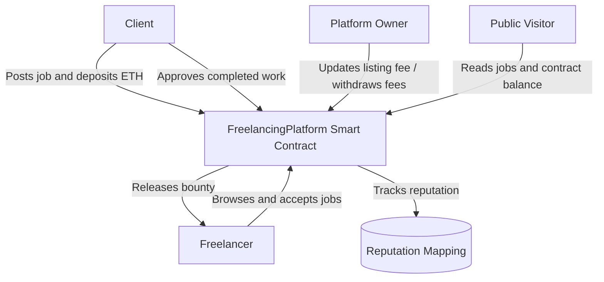
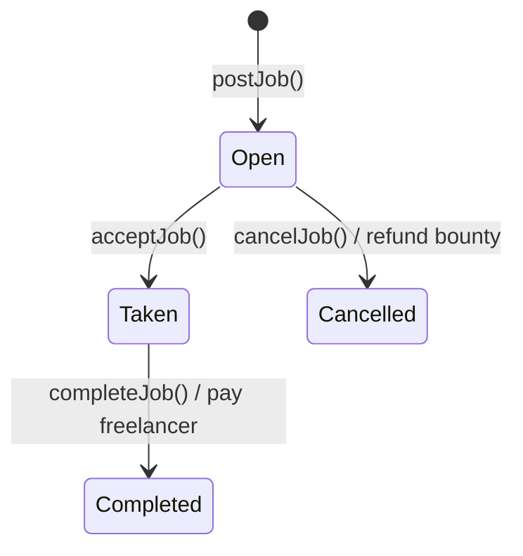

# Freelance Marketplace DApp

A Solidity learning project that models a decentralized freelance marketplace on Ethereum. Clients can publish jobs with an ETH bounty held by the contract, freelancers can accept available jobs, and the client can approve completion to release the bounty. The contract also tracks platform listing fees and a simple on-chain reputation score.

> **Project status:** Core contract implemented and manually tested in Remix. This is an educational project, not a production-ready or audited marketplace.

## Table of Contents

- [Overview](#overview)
- [Features](#features)
- [Project Structure](#project-structure)
- [Architecture](#architecture)
- [Job Lifecycle](#job-lifecycle)
- [Payment and Accounting Model](#payment-and-accounting-model)
- [Contract Interface](#contract-interface)
- [Manual Testing](#manual-testing)
- [Security Considerations and Limitations](#security-considerations-and-limitations)
- [Future Improvements](#future-improvements)

## Overview

The project explores how selected rules of a freelance marketplace can be enforced by a smart contract rather than relying exclusively on a traditional centralized backend.

In a conventional Web2 marketplace, a backend service and database commonly manage job listings, assignments, payment status, and reputation records. In this project, the job lifecycle and ETH escrow rules are represented in Solidity and executed according to Ethereum's protocol.

The contract does not provide a frontend or a complete marketplace service. It is the on-chain component that a future DApp frontend could interact with.

## Features

- **Post a job:** A client publishes a title and description and sends ETH to cover both the listing fee and a positive bounty.
- **Escrow a bounty:** The contract keeps the bounty reserved until the job is completed or an open job is cancelled.
- **Accept a job:** A freelancer can accept an open job. The client cannot accept their own job, and a job cannot be accepted again after its status changes.
- **Approve completion and pay:** The client marks a taken job as completed. The contract releases the bounty to the assigned freelancer and increases their reputation score.
- **Cancel an open job:** The client can cancel a job only while it is open. The bounty is refunded, while the listing fee remains accrued to the platform.
- **Track platform fees:** Listing fees are recorded separately from escrowed bounties.
- **Withdraw platform fees:** Only the owner can withdraw accrued platform fees.
- **Update the listing fee:** Only the owner can change the fee for future job listings.
- **Inspect marketplace data:** Callers can retrieve one job, retrieve all jobs, inspect the contract's ETH balance, and read public state variables.

## Project Structure

```text
day-19-final-project/
├── README.md
├── FreelanceMarketplace-UseCase.drawio
└── FreelanceMarketplace.sol
```

- `FreelanceMarketplace.sol`: Solidity implementation. The contract is named `FreelancingPlatform`.
- `FreelanceMarketplace-UseCase.drawio`: editable use-case diagram for the actors and main interactions.
- `README.md`: project scope, design, workflow, interface, and test checklist.

## Architecture



The contract can be paired with a frontend and wallet integration later. Those off-chain components are outside the current scope.

## Job Lifecycle



The current contract supports cancellation only while the job is `Open`. It does not implement cancellation or dispute resolution after a freelancer has accepted a job.

## Payment and Accounting Model

When `postJob()` is called, `msg.value` must exceed the current `listingFee` so that the job has a positive bounty.

```text
ETH sent with postJob
├── listingFee  -> recorded in platformFeesAccrued
└── remaining   -> stored as the job bounty and added to totalEscrowed
```

Accounting variables:

- `totalEscrowed`: total bounty funds reserved for jobs that have not reached a terminal state.
- `platformFeesAccrued`: listing fees collected but not yet withdrawn.
- `getPlatformBalance()`: the contract's raw ETH balance. This includes both escrowed funds and accrued platform fees; it should not be interpreted as freely withdrawable revenue.

When a job is completed, its bounty is transferred to the assigned freelancer and removed from `totalEscrowed`. When an open job is cancelled, its bounty is refunded to the client and removed from `totalEscrowed`. The listing fee is not refunded by the current cancellation policy.

Under normal contract flows, the contract's balance should cover `totalEscrowed + platformFeesAccrued`. Ethereum contracts can sometimes receive ETH outside the ordinary function flow, so raw balance and internal accounting are conceptually distinct.

## Contract Interface

| Function | Access | Purpose |
|---|---|---|
| `postJob(title, description)` | Any caller, payable | Creates an open job and accounts for the listing fee and bounty. |
| `getJob(jobID)` | Public read | Returns a job after validating its ID. |
| `getAllJobs()` | Public read | Returns all jobs currently recorded by the contract. |
| `acceptJob(jobID)` | Any caller other than the client | Assigns an open job to one freelancer. |
| `completeJob(jobID)` | Job's client only | Marks a taken job complete, pays its bounty, and rewards reputation. |
| `cancelJob(jobID)` | Job's client only | Cancels an open job and refunds its bounty. |
| `setListingFee(amount)` | Owner only | Updates the listing fee for future jobs. |
| `withdrawPlatformFees()` | Owner only | Withdraws fees accumulated by the platform. |
| `getPlatformBalance()` | Public read | Returns the contract's current ETH balance in wei. |

Important state and behavior:

- `JobStatus` defines `Open`, `Taken`, `Completed`, and `Cancelled`.
- `jobs` stores job details by ID. Job IDs start at `1`.
- `freelancerReputation` increases by `REPUTATION_REWARD` when the client completes a job.
- Events record job creation, acceptance, completion, cancellation, fee updates, and platform fee withdrawals.
- Custom errors are used for common invalid operations and access-control failures.

## Manual Testing

The contract was compiled and manually tested in Remix. Re-run these checks after any changes:

| Scenario | Expected result |
|---|---|
| Post a job with listing fee plus a positive bounty | Job is created as `Open`; fee and escrow accounting increase. |
| Send less than the required listing fee | Transaction reverts with `InsufficientFunds`. |
| Send exactly the listing fee without a bounty | Transaction reverts with `BountyMustBePositive`. |
| Accept a valid open job from a non-client account | Job becomes `Taken` and records the freelancer. |
| Client tries to accept their own job | Transaction reverts. |
| Call a job function with an invalid job ID | Transaction reverts with `JobNotFound`. |
| Client completes a taken job | Job becomes `Completed`, bounty is paid, escrow decreases, and reputation increases. |
| A non-client attempts to complete the job | Transaction reverts. |
| Client cancels an open job | Job becomes `Cancelled` and the bounty is refunded. |
| Client tries to cancel a taken job | Transaction reverts. |
| Non-owner attempts to change the fee or withdraw platform fees | Transaction reverts. |
| Owner withdraws accrued listing fees | Only accrued platform fees are transferred; escrowed bounties remain reserved. |

These are manual scenario checks, not a formal automated test suite or an independent security audit.

## Security Considerations and Limitations

- **Educational scope:** Do not treat this project as production-ready or deploy it with valuable funds without further work and a professional security review.
- **No dispute process:** The contract trusts the client to approve completion. It does not arbitrate disagreements between clients and freelancers.
- **Cancellation policy:** Only open jobs can be cancelled. There is no cancellation path after acceptance.
- **Simple reputation:** Reputation increases automatically on completion. There are no star ratings, written reviews, or protections against collusive behavior beyond the contract's current rules.
- **Unbounded job listing:** `getAllJobs()` loops over every job. It is convenient for a small learning project, but a production frontend should consider pagination, event indexing, or another scalable read pattern.
- **Owner privileges:** The owner can change the listing fee and withdraw accrued fees. Users must understand this trust assumption.
- **Manual tests only:** No automated test framework or formal audit is included in this repository version.
- **External ETH transfers:** Payment operations use low-level `call` and check success. More comprehensive testing and security analysis are still necessary.

## Future Improvements

- Add automated unit tests with Foundry or Hardhat.
- Add a frontend and wallet connection.
- Add pagination or indexed queries for job listings.
- Define a dispute and cancellation policy for jobs that have already been accepted.
- Extend the reputation model with reviews and additional validation rules.
- Consider a stronger ownership model, such as a two-step ownership transfer, if administrative control remains necessary.
- Perform an independent security review before any real-value deployment.

---

This project is part of my ongoing Web3 and Blockchain learning journey, focusing on applying Solidity concepts to a more complete smart-contract workflow.
