# Freelance Marketplace DApp

A Solidity learning project that explores how a freelance marketplace could use smart contracts to coordinate clients, freelancers, jobs, payments, and reputation on Ethereum.

> **Project status:** Requirements and use-case modeling  
> **Format:** Final project, built incrementally across two study sessions  
> **Primary focus:** Smart-contract design, state management, access control, and safe workflow transitions

This project is part of my ongoing **Web3 & Blockchain learning journey**. The goal is not only to make a contract compile, but to understand the rules that govern the marketplace and encode them clearly in Solidity.

---

## Table of Contents

- [Project Overview](#project-overview)
- [Project Structure](#project-structure)
- [Problem Statement](#problem-statement)
- [Actors and Use Cases](#actors-and-use-cases)
- [Use-Case Diagram](#use-case-diagram)
- [High-Level Workflow](#high-level-workflow)
- [Design Questions to Resolve](#design-questions-to-resolve)
- [Two-Session Implementation Plan](#two-session-implementation-plan)
- [Learning Objectives](#learning-objectives)
- [Current Scope and Limitations](#current-scope-and-limitations)

---

## Project Overview

The Freelance Marketplace DApp models a marketplace where clients publish jobs and freelancers discover and accept suitable work. The project also considers payment and reputation as part of the overall user experience.

The current use-case model contains six primary actions:

- **Client:** Post Job, Review Job
- **Freelancer:** Browse Jobs, Accept Job, Get Paid, Build Reputation

The use-case diagram captures the intended user interactions. The exact smart-contract rules behind those interactions will be defined before implementation, rather than assumed from the diagram alone.

## Project Structure

```text
day-19-final-project/
├── README.md
├── FreelanceMarketplace-UseCase.drawio
└── FreelanceMarketplace.sol
```

- `FreelanceMarketplace.sol` is the initial Solidity contract scaffold. It intentionally contains no marketplace logic yet; requirements and payment rules will be clarified before implementation.
- `FreelanceMarketplace-UseCase.drawio` contains the editable use-case diagram.
- `README.md` documents the project's goals, use cases, and implementation plan.

## Problem Statement

In a conventional Web2 freelance marketplace, a platform's backend and database usually manage job listings, assignment, payment state, and reviews. Users rely on the platform operator to apply the rules and maintain its records.

A blockchain-based design can place selected rules and state transitions in a smart contract, where transactions are processed according to the network's protocol. This does not automatically make every part of an application decentralized: a frontend, hosting, notifications, file storage, and other services may still be operated separately.

This project is a small learning exercise for exploring which marketplace rules could be represented in Solidity and what trade-offs that introduces.

## Actors and Use Cases

| Actor | Use case | Intended purpose |
|---|---|---|
| Client | **Post Job** | Publish a job with the details required by the marketplace. |
| Client | **Review Job** | Submit a review under the rules agreed for the project. |
| Freelancer | **Browse Jobs** | Discover jobs that are available to accept. |
| Freelancer | **Accept Job** | Accept an eligible job, subject to the marketplace's assignment rules. |
| Freelancer | **Get Paid** | Receive payment when the agreed payment conditions are met. |
| Freelancer | **Build Reputation** | Build a reputation through the marketplace's review process. |

These descriptions are intentionally high-level. A use case describes what an actor wants to achieve; it does not, by itself, specify permissions, validation rules, payment mechanics, or every possible failure condition.

## Use-Case Diagram

The following diagram is also available as an editable Draw.io file: [`FreelanceMarketplace-UseCase.drawio`](./FreelanceMarketplace-UseCase.drawio).

```mermaid
flowchart LR
    Client([Client])
    Freelancer([Freelancer])

    subgraph Marketplace[Freelance Marketplace DApp]
        direction TB
        PostJob([Post Job])
        ReviewJob([Review Job])
        BrowseJobs([Browse Jobs])
        AcceptJob([Accept Job])
        GetPaid([Get Paid])
        BuildRep([Build Reputation])
    end

    Client --- PostJob
    Client --- ReviewJob
    Freelancer --- BrowseJobs
    Freelancer --- AcceptJob
    Freelancer --- GetPaid
    Freelancer --- BuildRep

    classDef actor fill:#E0F2FE,stroke:#0369A1,color:#0F172A,stroke-width:1.5px;
    classDef usecase fill:#F8FAFC,stroke:#64748B,color:#0F172A,stroke-width:1.5px;
    class Client,Freelancer actor;
    class PostJob,ReviewJob,BrowseJobs,AcceptJob,GetPaid,BuildRep usecase;
```



## High-Level Workflow

The diagram suggests this broad user journey:

1. A client posts a job.
2. Freelancers browse the available listings.
3. A freelancer accepts a job according to the contract's eligibility and assignment rules.
4. The marketplace handles payment when its defined conditions are satisfied.
5. A client can review the job, and the review process contributes to freelancer reputation according to the rules we implement.

This is a conceptual workflow, not yet a final state machine. For example, the current diagram does not specify all job statuses or exactly when work is considered complete.

## Design Questions to Resolve

Before writing the full implementation, the following rules need to be made explicit:

- **Job data:** Which fields are required when a client posts a job?
- **Access control:** Who can post, accept, review, or trigger a payment-related action?
- **Assignment:** Can a job be accepted by only one freelancer, and how is a job made unavailable after acceptance?
- **Lifecycle:** Which job statuses are needed, and which transitions are allowed?
- **Payment:** Who provides funds, when does payment become available, and what happens if the work is not completed? The diagram includes “Get Paid” but does not define an escrow model or payment conditions.
- **Reviews and reputation:** Who may submit a review, when can it be submitted, and how do we prevent duplicate or unrelated reviews?
- **Failure cases:** What should happen if someone calls a function at the wrong stage or without the required permissions?

These decisions will guide the contract's data model, functions, modifiers, events, and tests.

## Two-Session Implementation Plan

### Session 1: Foundation and Core Job Flow

- Confirm the requirements and rules above.
- Define the job data model and required state.
- Plan the core flows for posting, browsing, and accepting jobs.
- Implement and test the agreed initial behavior.

### Session 2: Completion, Payment, and Reputation

- Complete the remaining agreed job lifecycle.
- Implement payment behavior only after its rules are clear.
- Add the review and reputation flow.
- Test permissions, invalid state transitions, duplicate actions, and relevant edge cases.
- Update this README to document the final implementation and test results.

The plan may be adjusted as we clarify the requirements. The aim is to build understanding and correct behavior incrementally, not to rush into code before the rules are clear.

## Learning Objectives

Through this project, I aim to practise:

- Modeling real-world entities and relationships in Solidity.
- Managing contract state and job lifecycle transitions.
- Applying access control and validation rules.
- Designing clear function interfaces and custom error handling where appropriate.
- Emitting events for important state changes.
- Thinking about payment safety, trust assumptions, and smart-contract limitations.
- Testing both successful workflows and invalid or unauthorized actions.
- Documenting a project so that its purpose and design can be understood by others.

## Current Scope and Limitations

- This is an educational project, not a production-ready freelance platform.
- The use-case diagram is a starting point; payment, completion, and reputation rules still need to be specified and tested.
- A compiling contract is not necessarily secure. Any future deployment involving real funds would require substantially more testing and an independent security review.
- The current diagram describes user interactions. It does not imply that every part of a future application, such as its frontend or file storage, will be decentralized.

---

**Learning in public:** This project is part of my ongoing journey to understand not just how to write Solidity, but how to design and reason about smart-contract systems.
